# HelloAI

> **把需求交给一支 AI 团队，而不是一个 AI。**

<p align="center">
  
  
  
  
  
</p>

你的电脑上可能已经装了好几个 AI：Trae 写代码、Qoder 改 Bug、Claude Code 跑命令……但它们彼此不认识。拆任务、派活、催进度、验收，全得你自己来。

HelloAI 就是来替你当这个「项目经理」的：

**你说一次需求，它把任务拆开，派给你各台电脑上的 AI 并行去做；做得不合格的，带着具体修改意见打回重做；最后整合成一份完整交付，交到你手上。**

全程，你只说一次需求、点一次确认。

<p align="center">
  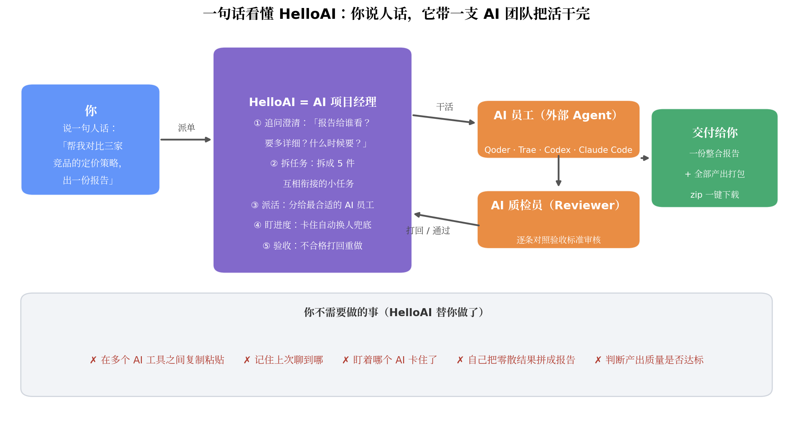
</p>

> 🧭 **在线体验**：[helloai.456qwe-3.workers.dev](https://helloai.456qwe-3.workers.dev/) —— 本 README 全文的交互版，配 9 张可拖拽 / 缩放 / 悬停高亮的架构图（个别网络环境可能打不开）

**它和别的 AI 平台有什么不同？**

- **不只用自家的 AI** —— 除了内置模型，它还能调动你其他电脑上的 AI 软件（Trae / Qoder / Claude Code……）同场协作。跨终端、跨厂商，接入不用改它们一行代码
- **不是跑完就算** —— 每件交付都有 AI 质检员逐项验收：不合格就带着具体意见打回返工；反复不过关会主动停下来等你处理，而不是糊弄着交差
- **只对结果负责** —— 你不用管它怎么拆、怎么派。你要的是结果，它交的也是结果

> 📖 完整定位、行业分工与主流方案对比 → [`doc/产品定位与对比.md`](doc/产品定位与对比.md)

---

## 🎬 它是怎么工作的？（30 秒版）

**你只需要做两件事：描述需求 + 确认草案。** 剩下的全部自动流转：

```
你说需求 → Planner 追问澄清 → 拆成带依赖关系的子任务
        → 派给最合适的 AI 并行执行 → 质检员逐项验收（不合格打回）→ 整合成完整交付
```

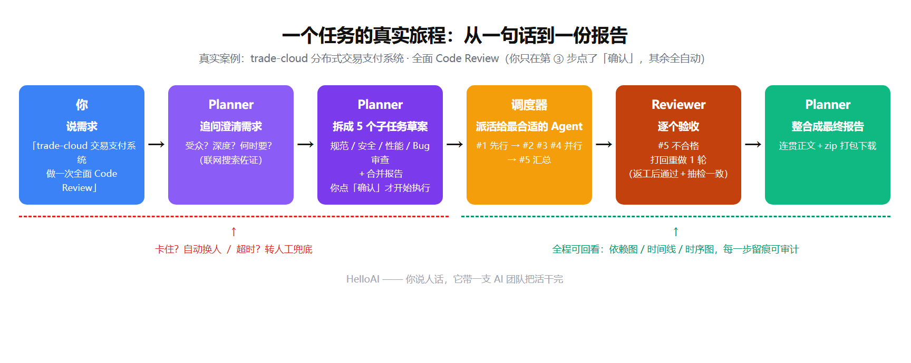

---

## 🚀 快速开始

两种方式，按「你想干什么」选：

| | **一键安装（推荐）** | 源码部署 |
|---|---|---|
| 适合 | 直接跑起来、部署到自己的服务器 | 二次开发 / 调试 / 改代码 |
| 需要 JDK / Maven / Node | ❌ 都不需要 | ✅ 全要 |
| 需要 Docker + Compose | ✅ | ✅（只跑中间件） |
| 需要源码 | ❌ 不用 `git clone` | ✅ 全量 |
| 起步动作 | 一行命令（脚本管道给 bash） | `git clone` → `mvn package` → `npm run dev` |
| 首次耗时 | 5~10 分钟（拉镜像） | 10~20 分钟 |

### 方式 A：一键安装（推荐）

**不需要 JDK / Maven / Node，也不需要先 `git clone`。** 只要 Docker + Docker Compose（v2）。

```bash
curl -fsSL https://gitee.com/undefined_404/helloai/raw/master/deploy/install.sh \
  | HELLOAI_REF=v0.2.1 bash
```

它会从 [Gitee 发行版](https://gitee.com/undefined_404/helloai/releases) 取 **28 KB** 的 quickstart 包，
铺到 `./helloai`，然后拉起整套栈。`app` / `web` 用**公开 ACR** 上的预构建镜像，匿名可拉、不用登录。

打开 <http://localhost:8080>（服务器上是 `http://<公网IP>:8080`），默认管理员 **admin / admin123**。

常用参数（都是环境变量，**必须放在管道右侧 `bash` 前面**）：

```bash
# 装到指定目录（默认 ./helloai）
curl -fsSL …/install.sh | HELLOAI_INSTALL_DIR=$HOME/helloai HELLOAI_REF=v0.2.1 bash

# 带沙箱（画图 / 技能执行）；`--` 之后的一切原样传给 start.sh
curl -fsSL …/install.sh | HELLOAI_REF=v0.2.1 bash -s -- --with-sandbox
```

> ⚠️ `HELLOAI_REF=v0.2.1 curl … | bash` **是错的**——变量只作用于 `curl`，不会传给管道的接收端，结果会静默按默认分支安装。
>
> 🔒 **默认密码固定写在 Flyway 迁移里，启动前改不了**。登进去第一件事改密码；对外暴露时把安全组 / 防火墙来源收紧到你自己的 IP，不要 `0.0.0.0/0`。
>
> 🌐 **服务器部署**：容器 80 映射到宿主 **8080**（改 `.env` 的 `HELLOAI_HTTP_PORT` 可换），记得放行该端口。只想自己用就走 SSH 隧道 `ssh -N -L 8080:127.0.0.1:8080 root@<IP>`，防火墙一条都不用开。
>
> 💾 **内存**：核心模式建议 ≥ 3.5 GB；`--with-sandbox` 建议 ≥ 5.5 GB（4 GB 机器请只跑核心模式）。
>
> 🎨 **要画图 / 技能执行**：加 `--with-sandbox`（额外拉约 2 GB 镜像）。
>
> 📦 **手动安装 / 断网**：从 [发行版](https://gitee.com/undefined_404/helloai/releases) 下载 `helloai-quickstart-*.tar.gz`，解压后 `./start.sh`（Windows：`.\start.ps1`）；离线镜像包走 `./start.sh --offline`。完整说明见包内 `README.md` 或 [`deploy/quickstart/README.md`](deploy/quickstart/README.md)。

> ⚠️ **前提**：中间件（postgres / redis / rabbitmq / minio）仍从 Docker Hub 拉。国内建议先配好 Docker 镜像加速（`registry-mirrors`），否则这一步可能较慢。

### 方式 B：源码部署（二次开发）

面向本地开发、二次开发。**必须先 `git clone`**，后端构建（Maven）和前端开发服务器（Node）都依赖源码树。

```bash
# 1. 克隆
git clone https://gitee.com/undefined_404/helloai.git && cd helloai

# 2. 准备 OpenSandbox 配置（含本机工作区白名单，不入库，故需先复制模板）
cp opensandbox-config.example.toml opensandbox-config.toml
#    不改也能正常起：默认拒绝一切宿主路径挂载
#    （只有跑带卷沙箱时才需改 [storage].allowed_host_paths，见文件内注释）

# 3. 启动中间件（PostgreSQL / Redis / RabbitMQ / MinIO / OpenSandbox server）
docker compose up -d

# 4. 启动后端（Flyway 自动建表；本地开发请用 local profile，见下方警告）
mvn clean package -DskipTests
java -jar helloai-start/target/helloai-start-1.0.0-SNAPSHOT.jar --spring.profiles.active=local

# 5. 启动前端
cd helloai-ui && npm install && npm run dev
```

访问 `http://localhost:6565/swagger-ui.html` 查看 API 文档。

> ⚠️ **后端默认激活 `dev` profile（云服务器联调）**：本地纯 Docker 开发请在启动参数加 `--spring.profiles.active=local`，否则会连云上数据源。
>
> 只是想让服务跑起来（不改代码）的话，**用方式 A 就够了**——它连源码都不需要。想把本地构建产物部署到服务器，用 [`deploy/app/docker-compose.yml`](deploy/app/docker-compose.yml)。

---

## 📸 界面预览

<div align="center">

| 需求澄清 | 对话产物 | 依赖 DAG |
|:---:|:---:|:---:|
| 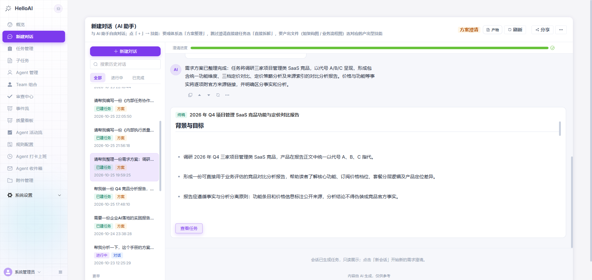 | 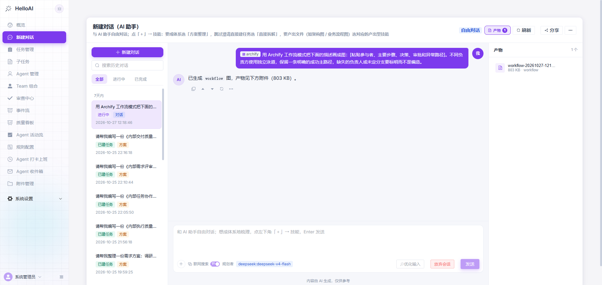 | 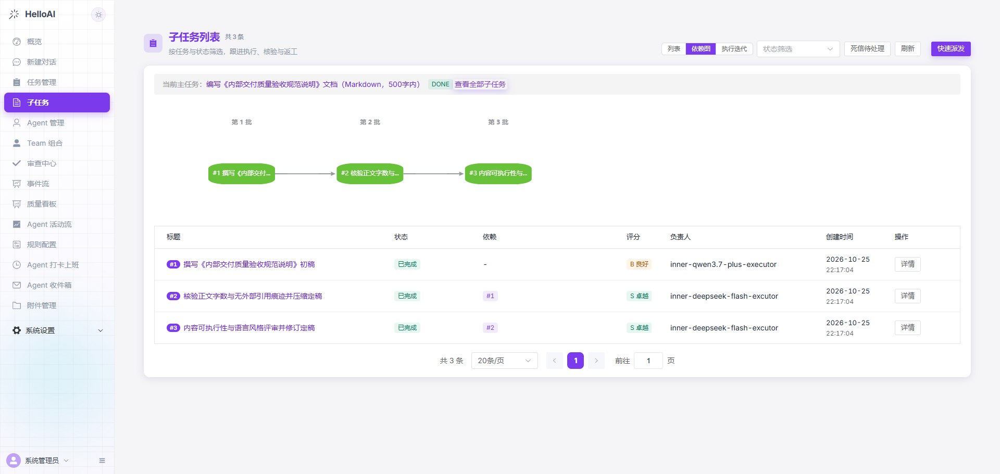 |

| 概览 | 任务管理 | Agent 管理 |
|:---:|:---:|:---:|
| 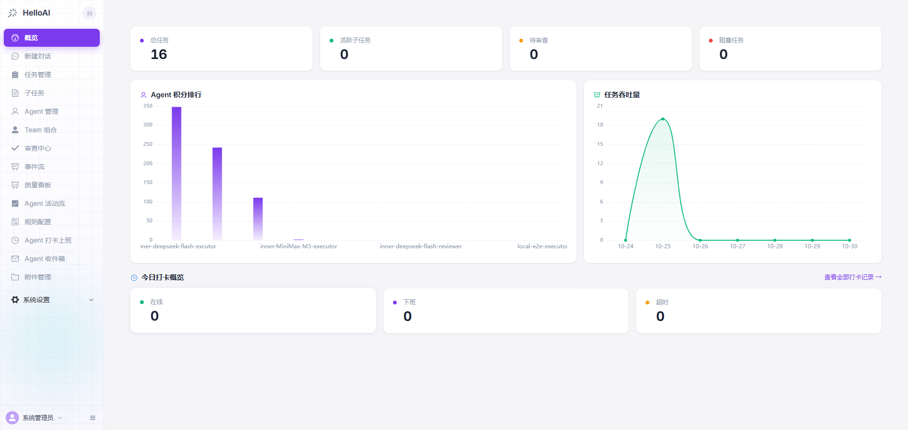 | 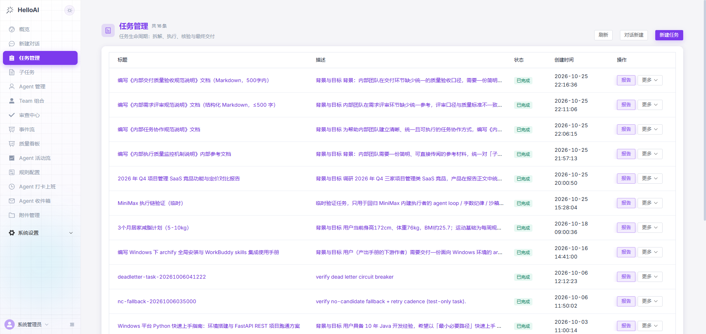 | 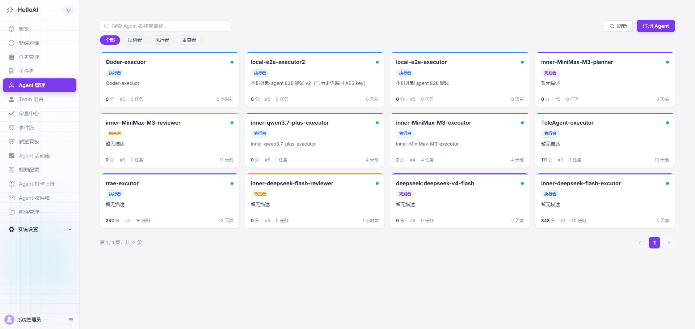 |

| Team 组合 | 执行迭代 | 子任务详情 |
|:---:|:---:|:---:|
| 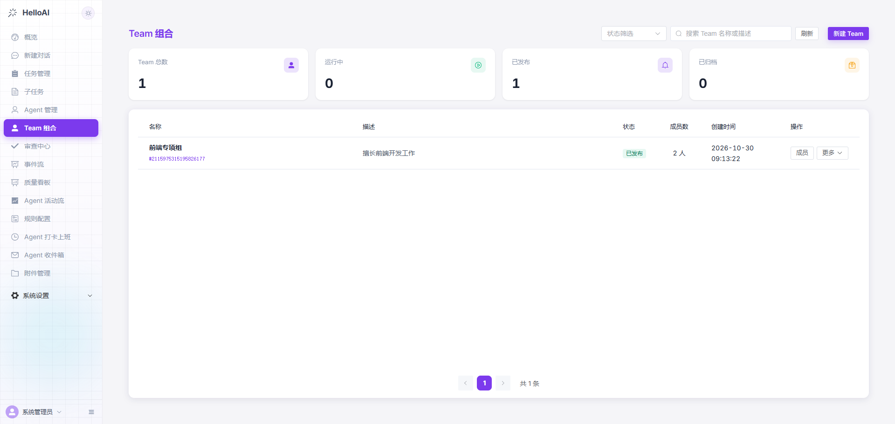 | 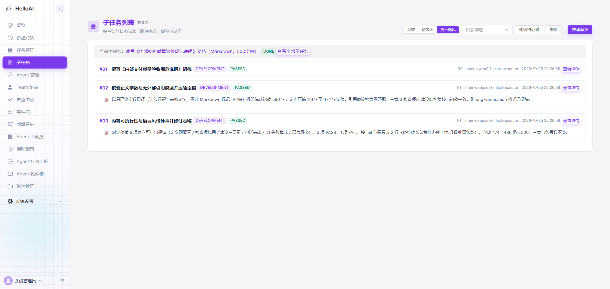 | 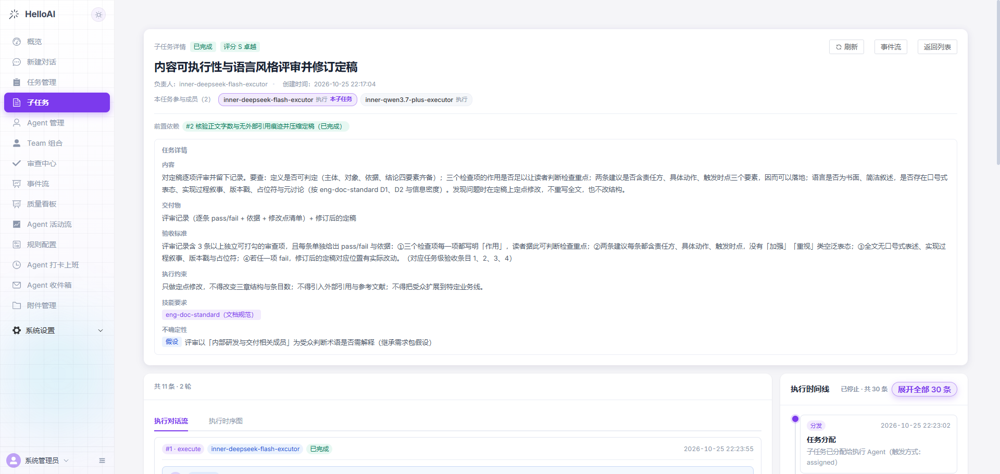 |

</div>

<details>
<summary><b>展开看细节：执行对话流 / 质量看板 / 审查中心</b></summary>

<table>
<tr>
<td width="33%" valign="top">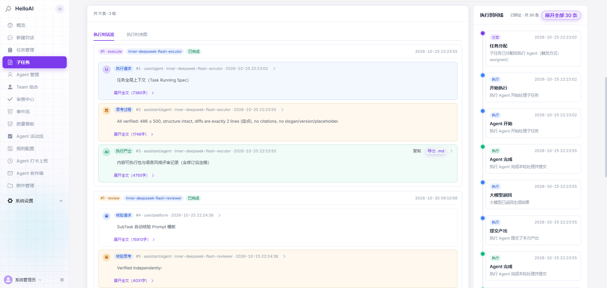<br><sub>执行对话流 —— 任务上下文 / 思考 / 产出 / 核验全过程</sub></td>
<td width="33%" valign="top">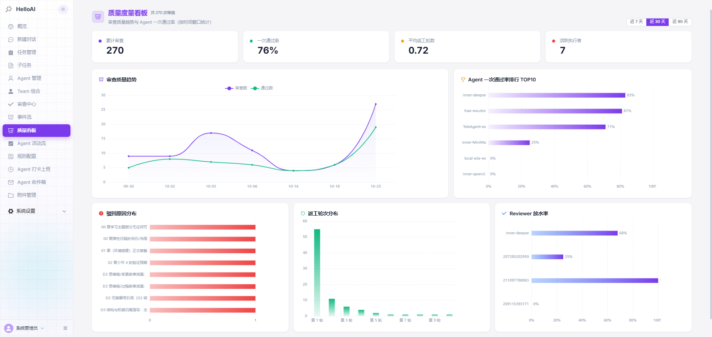<br><sub>质量看板 —— 一次通过率 / 返工轮次 / 驳回原因</sub></td>
<td width="33%" valign="top">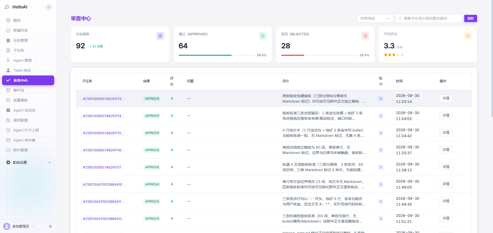<br><sub>审查中心 —— Reviewer 逐项验收与评分</sub></td>
</tr>
</table>

</details>

<details>
<summary><b>展开：外部 Agent 接入三件套（事件流回放 / 收件箱 / 打卡值班）</b></summary>

<table>
<tr>
<td width="33%" valign="top">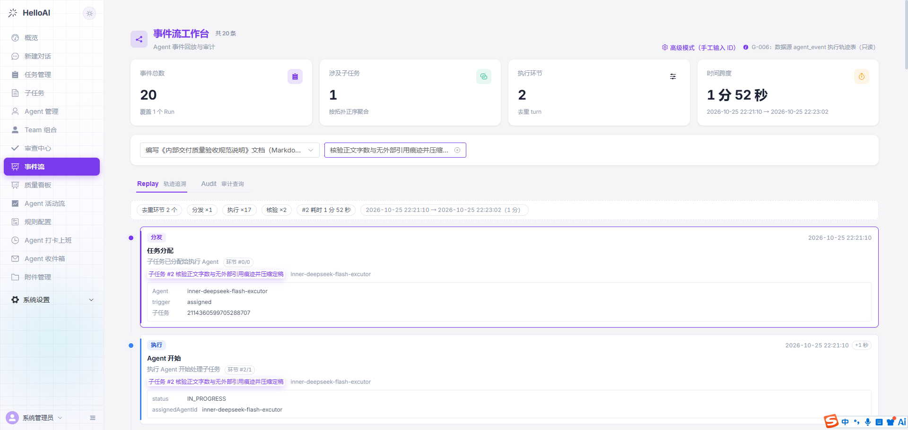<br><sub>事件流工作台 —— Agent 事件回放与审计追溯</sub></td>
<td width="33%" valign="top">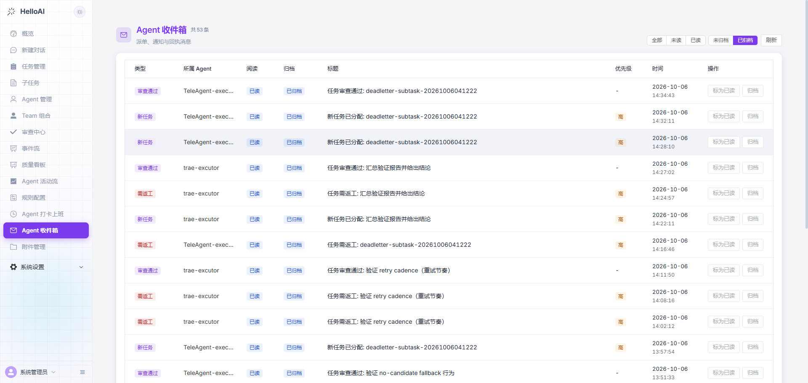<br><sub>Agent 收件箱 —— 派单 / 通知 / 返工消息投递</sub></td>
<td width="33%" valign="top">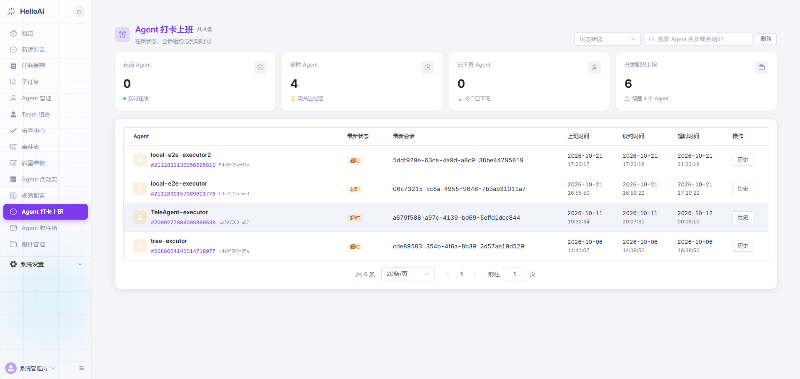<br><sub>打卡上班 —— 在岗状态 / 会话租约 / 到期时间</sub></td>
</tr>
</table>

</details>

<details>
<summary><b>展开：企业级权限体系（角色 / 接口权限 / 菜单路由）</b></summary>

<table>
<tr>
<td width="33%" valign="top">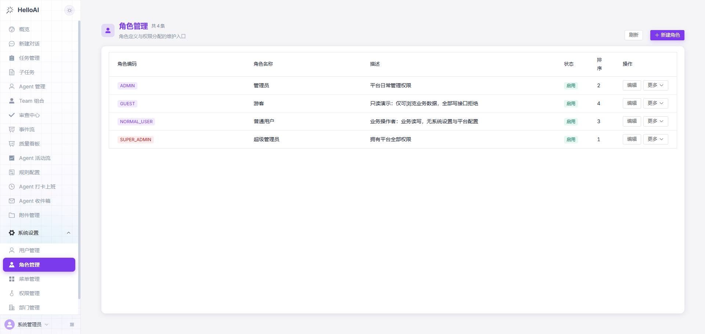<br><sub>角色管理 —— 超管 / 管理员 / 普通用户 / 游客</sub></td>
<td width="33%" valign="top">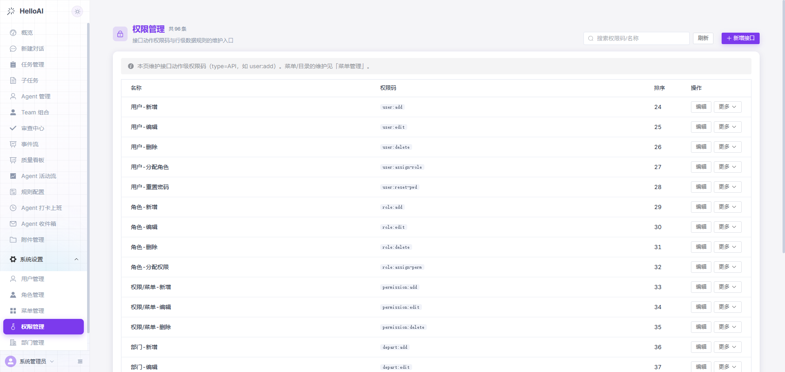<br><sub>权限管理 —— 接口级动作权限与行级数据规则</sub></td>
<td width="33%" valign="top">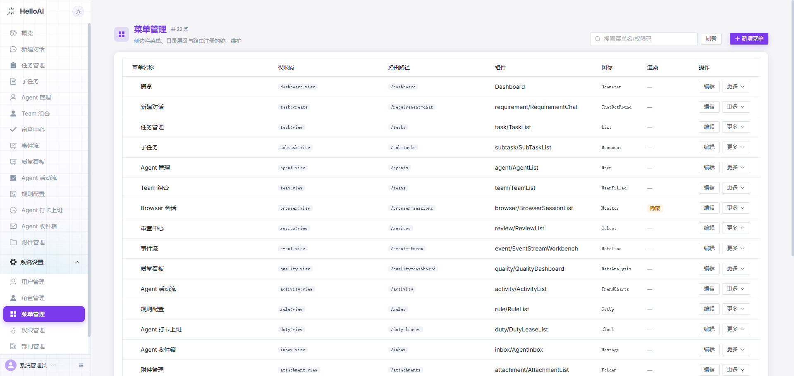<br><sub>菜单管理 —— 侧边栏 / 目录层级 / 路由注册</sub></td>
</tr>
</table>

</details>

更多截图见 [`doc/images/`](doc/images/)。

---

## 🗺️ 功能与路线图

**它已经能做什么**（完整迭代记录见 [`doc/log/`](doc/log/)）

- **异构协作（核心能力）**：内置 LLM 与外部 AI Agent 同台执行同一个任务——外部 Agent 按「打卡 → 领任务 → 干活 → 提交」的异步模式工作，两边由平台统一派单、统一验收
- **任务编排**：Planner 先追问澄清你的真实意图，再按执行者的能力拆任务；拆得不合适可以退回重拆，执行中发现干不完还能二次拆解派生
- **质量闭环**：AI 质检员逐项核验，驳回必须给出具体修改意见；重大交付支持双人复核与抽检
- **出了问题能兜底**：执行者掉线自动回收重派、反复失败转人工兜底、每一步都有事件流可回放审计
- **开箱即用**：管理端界面、个人工作台、权限体系、额度监控、Docker 一键私有化部署

**接下来要做什么**

- [ ] 验收标准自动化：规则校验 + 测试 + LLM 评审统一决策，不再只靠「AI 看一遍觉得行」
- [ ] git worktree 代码隔离：改代码的任务各用独立工作区，并行执行互不踩踏
- [ ] 按执行环境派活：任务需要特定仓库或环境时，只派给具备条件的执行者，不匹配就显式阻塞
- [ ] 增强跨文档核验：上游产物按引用注入执行环境，不再靠在沙箱里翻文件系统
- [ ] 技能自主选择与安装：执行体按任务自行挑选并安装所需技能，而不是预先全量挂载
- [ ] 任务可取消 + 结构化交付
- [ ] 更多 AI 软件开箱接入：CLI 适配器（命令契约 / 输出解析），不限于 MCP
- [ ] A2A 协议兼容层：把平台内的 Agent 暴露为 A2A 对等体，与标准生态互通
- [ ] 沙箱隔离可选形态：Docker / 远程 / K8s 真实隔离

> 完整路线图与历史迭代见 [`doc/log/`](doc/log/) 与 [项目基线](doc/HelloAI%20项目基线文档.md)。

---

## 🛠️ 技术细节（给想深入的人）

**Java 17 + Spring Boot 3.4 + Vue 3 + PostgreSQL/Redis/RabbitMQ/MinIO**，Docker Compose 完全私有化。

交互式架构与流程图（可缩放 / 深色模式 / 节点带源码锚点）：

| 主题 | 图 |
|---|---|
| 系统架构（部署视图） | [打开](doc/diagrams/html/helloai-system-architecture.html) |
| 平台任务调度总览 | [打开](doc/diagrams/html/platform-scheduling-flow.html) |
| 子任务状态机（12 态） | [主干](doc/diagrams/html/subtask-state-machine.html) · [派生与重构](doc/diagrams/html/derived-restructuring-branch.html) |
| 主任务与报告状态机 | [打开](doc/diagrams/html/task-report-state.html) |
| LLM 内部执行控制流 | [打开](doc/diagrams/html/llm-internal-execution.html) |
| 沙箱执行与证据审批 | [打开](doc/diagrams/html/sandbox-evidence-approval.html) |
| Planner / Executor / Reviewer | [Planner](doc/diagrams/html/planner-flow-and-state.html) · [Executor](doc/diagrams/html/executor-flow-and-state.html) · [Reviewer](doc/diagrams/html/reviewer-flow-and-state.html) |

> 模块结构与技术栈 → [`doc/技术概览.md`](doc/技术概览.md) · 目标架构 → [`doc/HelloAI 目标架构.md`](doc/HelloAI%20目标架构.md) · 全部文档 → [`doc/README.md`](doc/README.md)

---

## 📚 文档导航

| 你想做什么 | 去哪里 |
|---|---|
| **了解架构设计** | [文档地图](doc/README.md) → 项目基线 / 目标架构 / 设计文档 |
| **接入外部 AI Agent** | [值守手册](doc/manual/executor-duty/manual-assembled.md) — SKILL 生成 / MCP 连接 / 打卡 / 领任务 / 提交 / 心跳 / 排障 |
| **查看任务状态机** | [子任务状态机（12 态）](doc/diagrams/html/subtask-state-machine.html) · [主任务与报告状态机](doc/diagrams/html/task-report-state.html) |
| **浏览交互式架构图** | [doc/diagrams/html/](doc/diagrams/html/) |
| **了解适用边界** | [诚实的能力边界](doc/HelloAI%20项目基线文档.md)（§2.6） |
| **参与开发** | [代码规范](doc/HelloAI_CODE_STYLE.md) · [项目基线](doc/HelloAI%20项目基线文档.md) |
| **查看迭代记录** | [doc/log/](doc/log/) — 按月归档的功能线汇总 |
| **English** | [README.en.md](README.en.md) |

---

## ❓ FAQ

**Q：A2A 是什么？HelloAI 和它是什么关系？**

A：MCP 让 Agent 会用工具，A2A 让不同厂商的 Agent 能互相协作。协议标准已经有了，但「谁拆活、派给谁、验收什么、失败怎么兜、事后怎么对账」这一层落地机制仍然缺——这正是 HelloAI 补的位置。目前 Agent 接入走 MCP，A2A 兼容层已在路线图上。

**Q：与 CrewAI / LangGraph / Dify 有什么区别？**

A：一句话：它们解决「如何写 Agent / 编排应用」，HelloAI 解决「**如何管 Agent**」——任务拆解、弹性调度、验收审计、全链路可视化，且基于 Java 企业级技术栈。

**Q：必须装 Java 环境吗？**

A：看你干什么。**一键安装不需要**——只要有 Docker 就行；JDK 17 只在你要二次开发源码时才需要。

**Q：支持哪些大模型？**

A：DeepSeek 实测可用，Moonshot / MiniMax / DashScope 预置。启动后在管理端「系统设置 → 模型配置」填写 API Key 即可，加密存储、实时生效、无需重启。

**Q：接入外部 AI（Qoder / Trae / Codex CLI / Claude Code）要改它的代码吗？**

A：不用。管理端创建 Agent 后一键生成 SKILL 说明，粘贴给外部 AI 执行，即可自动完成注册鉴权 → MCP 连接 → 值班打卡 → 轮询值守。

**Q：数据会离开我的服务器吗？**

A：支持完全私有化部署，任务、产出物、审计记录全部落在你自己的数据库；LLM API Key 经 AES-GCM 加密存入凭证库。任务内容仅会发送给你自行配置 API Key 的大模型服务。

---

## 🤝 参与贡献

1. Fork → 新建 `feat_xxx` / `fix_xxx` 分支
2. 改代码前读 [`代码规范`](doc/HelloAI_CODE_STYLE.md)；动调度 / 执行链先读 [`Agent_Runtime`](doc/design/Agent_Runtime.md) 与 [`Agent_Event_Stream`](doc/design/Agent_Event_Stream.md)
3. 提交前跑门禁，PR 附输出：

```bash
bash scripts/ci/ci-gate.sh                    # 全量：构建 + 真实单测 + 架构冻结 + 前端
bash scripts/ci/ci-gate.sh --quick --skip-ui  # 快速自检
```

> 高频坑：`JAVA_HOME` 指向 `ms-17.0.19` 会触发 JVM 崩溃（换 17.0.20.1+）；根 POM 默认 `skipTests=true`，手工跑测试须 `-DskipTests=false`。细节见 [`scripts/README.md`](scripts/README.md) §六。

---

## 🙏 致谢

机制与设计参考了 OpenMOSS、AgentTeams、DeepSeek Harness、Vibe-Skills、Octop、Paperclip、OpenSandbox 等开源项目，产品形态对标 Dify / LangGraph / CrewAI 等；文档站由 [Archify](https://github.com/tt-a1i/archify) 生成。

> 完整来源、借鉴程度与落点 → [`doc/参考与致谢.md`](doc/参考与致谢.md)

---

## 📄 许可证

本项目采用 [MIT 许可证](https://opensource.org/licenses/MIT) 开源，详见 [LICENSE](LICENSE)。

---

**Let AI Agents Work as a Team.**

如果这个项目对你有启发，欢迎点个 **Star ⭐** 支持一下；也欢迎来 [Issues](https://gitee.com/undefined_404/helloai/issues) 聊聊你的想法——哪怕只是说说你想让它干什么。
