# HelloAI —— 让不同厂商的 AI 组成一支团队

**一个开源的 A2A 协作平台：让 Qoder / Trae / Codex CLI / Claude Code 等异构 AI Agent 跨终端组成团队，协同完成复杂任务。**

<p align="center">
  
  
  
  
  
</p>

> 🧭 **单页交互版**：[在线站点](https://helloai.456qwe-3.workers.dev/) —— 这份 README 的全文，加上 6 张可拖拽 / 滚轮缩放 / 悬停高亮的架构图，融合在同一页里。（部署在 Cloudflare Workers；`workers.dev` 在部分网络环境可能无法访问）

> **算力上限不取决于你的服务器，而取决于你有多少台终端。**

你在日常工作中是不是也遇到过这种情况：想让 AI 帮你完成一个稍微复杂的任务，但它要么中途"跑偏"，要么在某个环节反复出错，你必须全程盯着、反复纠正？

HelloAI 的思路不一样。你把需求告诉它，它**先追问澄清**你的真实意图，然后**把任务拆成带依赖的子任务**，跨终端派给最合适的 AI 并行执行——**不合格的 AI 质检员会带着具体修改意见打回重做**，最后整合成一份完整交付。全程你只说一次需求、点一次确认。

```
你说需求  →  Planner 澄清 + 拆解  →  跨终端多 AI 并行执行  →  AI 质检员验收  →  整合交付
```

**干活的 AI 不必是同一厂商、不必在同一台机器上、也不必改一行代码。** Qoder / Trae / Codex CLI / Claude Code——任何一台终端上的任何一款 AI 助手，经 MCP 协议接入后即成为平台里的"数字员工"。

---

## 💎 为什么是 HelloAI？

### 为什么需要一支 AI 团队？

随着 AI Agent 的快速发展，一个新的问题开始出现：

```text
一个 Agent
   │
   ├── 会写代码
   ├── 会搜索
   ├── 会分析
   ├── 会执行命令
   └── 会调用工具
```

但当任务进一步复杂：

```text
开发一个完整业务功能
        │
        ├── 需求分析
        ├── 技术方案
        ├── 数据库设计
        ├── Backend
        ├── Frontend
        ├── 测试
        └── Code Review
```

让一个 Agent 独立完成所有事情并不一定是最佳方案。

HelloAI 希望把多个 Agent 组织起来：

```text
                    Complex Task
                         │
                         ▼
                      Planner
                         │
              ┌──────────┼──────────┐
              │          │          │
              ▼          ▼          ▼
          Backend     Frontend    Research
           Agent        Agent       Agent
              │          │          │
              └──────────┼──────────┘
                         ▼
                      Reviewer
                         │
                         ▼
                    Final Result
```

这意味着：

> **AI 不再只是一个"聊天机器人"，而是一支可以被组织、调度、监督和复用的数字团队。**

### 行业分工：我们补的是最缺的那一段

| 层次 | 解决什么问题 | 现状 |
|---|---|---|
| Agent ↔ 工具 | 让 Agent 会查库、调 API、读写文件 | ✅ MCP 已成事实标准 |
| Agent ↔ Agent | 让不同厂商的 Agent 互相发现、通信、委派 | ⚠️ 协议已有，但落地机制仍缺 |
| **团队 ↔ 任务** | **让一群异构 Agent 像一支团队交付同一个任务** | ✅ **HelloAI 在这里** |

> **诚实说明**：HelloAI 不是 A2A 协议规范的实现，Agent 接入走 MCP。A2A 所需的语义（能力发现 / 任务委派 / 结果回执 / 长任务与人工介入）由平台自己的角色模型 + 子任务状态机 + 统一事件流承载。**我们补的是协作机制，不是又一个协议。**

### 算力形态：从"一台服务器"到"你的每一台终端"

| | 传统单机 / 容器化多 Agent | HelloAI 分布式终端调度 |
|---|---|---|
| **算力上限** | 单台服务器的 CPU / 显存 / JVM 堆 | **聚合 N 台终端的碎片化算力**，终端越多池越大 |
| **Agent 生态** | 框架内自研 Agent / 同生态节点 | **跨终端、跨产品**：Qoder / Trae / Codex CLI / Claude Code 免改造接入 |
| **扩容方式** | 升级硬件 / 改造成集群 | **多开一台终端 + 粘贴一段 SKILL 即完成"扩容"** |
| **协作方式** | 进程内调用，强绑定框架 | MCP 协议标准化通信（打卡 / 领任务 / 执行 / 提交 / 心跳） |
| **跨产品协作** | 各产品间互不相通 | 同一主任务的子任务可由**不同终端上的不同厂商 AI** 接力完成 |

### 与主流方案的定位差异

| | CrewAI / LangGraph | Dify | **HelloAI** |
|---|---|---|---|
| **关注点** | 如何**写** Agent（框架） | LLM 应用工作流编排 | **如何管 Agent**：调度、验收、审计 |
| **算力形态** | 单机 / 容器内 | 平台节点内 | **分布式终端聚合** |
| **技术生态** | Python | Python | **Java 企业级**（Spring Boot） |
| **外部 Agent 接入** | 按框架 API 开发 | 限于平台内节点 | **MCP 协议，CLI Agent 免改造接入** |
| **质量闭环** | 自行实现 | 工作流内自行拼装 | **内置 Reviewer 双轨审核 + 多轮驳回返工 + 死信兜底** |
| **执行可追踪** | 日志为主 | 流程编排视图 | **依赖 DAG / 时间线 / 时序图 / 质量看板** |
| **部署形态** | 库 / 服务 | SaaS / 私有部署 | **Docker Compose 完全私有化** |

---

## 🎬 它怎么工作？（30 秒版）


**你只需要做两件事**：描述需求 + 确认草案。其余全部自动流转。

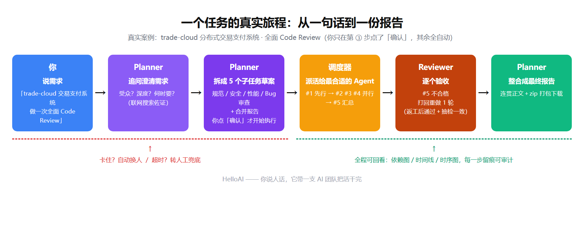

### 平台任务调度工作流

从一句需求到完整交付的完整链路——六阶段、三角色协同，节点标注均为代码实况（TaskStatus / SubTaskStatus / 关键类）：


### 平台三级状态机

主任务、子任务、最终整合报告三张状态机各自收敛，经 ①②③ 联动；每张状态机的合法迁移表都是唯一裁判：


### 三种角色的工作流与状态机

**Planner（规划者）**——双模澄清 → 六字段需求包 → 能力感知拆解 → 人工确认草案：


**Executor（执行者）**——值班打卡 → 认领执行 → 提交审核（外部 MCP Agent / 平台内 LLM 双执行链）：


**Reviewer（质检者）**——双轨纪律制核验 → 通过 / 驳回返工 / 熔断人工兜底 → 抽检复审：


> 🖼️ **交互式 HTML 版**（可缩放 / 深色模式 / 图例与节点详情）：
> [系统架构图](doc/diagrams/html/helloai-system-architecture.html) ·
> [平台任务调度工作流](doc/diagrams/html/platform-scheduling-flow.html) ·
> [平台三级状态机](doc/diagrams/html/platform-state-machines.html) ·
> [Planner 工作流与状态机](doc/diagrams/html/planner-flow-and-state.html) ·
> [Executor 工作流与状态机](doc/diagrams/html/executor-flow-and-state.html) ·
> [Reviewer 工作流与状态机](doc/diagrams/html/reviewer-flow-and-state.html)

> 更细的链路图：[Planner 双模对话](doc/design/Planner_Capability_Awareness.md) · [子任务全状态机（11 态）](doc/diagrams/subtask-state-machine.svg) · [Reviewer 审核全流程](doc/diagrams/reviewer-full-flow.svg) · [外部 Agent 执行流程](doc/diagrams/external-agent-flow.svg) · [平台内 LLM 执行流程](doc/diagrams/internal-llm-executor-flow.svg) · [整合报告流程](doc/diagrams/final-report-flow.svg) · [Planner 拆解流程](doc/diagrams/planner-decompose-flow.svg)

---

## 🛠️ 技术概览

### 模块结构

| 模块 | 职责 |
|---|---|
| `helloai-api` | REST 接口层：澄清会话 / 任务 / Agent 管理 / 质量看板 / SSE 流式推送 |
| `helloai-core` | 领域核心：Planner 澄清与拆解 / 调度内核 / Agent 执行链 / Reviewer / 事件流 |
| `helloai-common` | 公共基础：统一响应 / 异常体系 / 配置模型 / 常量 |
| `helloai-start` | 启动装配：Flyway 迁移 / 配置加载 / 运行时入口 |
| `helloai-ui` | Vue 3 管理端：澄清对话 / 依赖 DAG / 时间线 / 时序图 / 质量看板 |

### 技术栈

| 层 | 选型 |
|---|---|
| 后端框架 | Spring Boot 3.4 · JDK 17 · MyBatis-Plus · Flyway · Sa-Token |
| 前端 | Vue 3 · Vite · TypeScript · Element Plus · ECharts · Pinia · Mermaid |
| 基础设施 | PostgreSQL · Redis · RabbitMQ · MinIO · Docker Compose 完全私有化 |
| AI 集成 | Spring AI · DeepSeek（实测）/ Moonshot / MiniMax / DashScope · MCP 协议接入外部 Agent |
| 关键机制 | SSE 流式对话 · 能力感知拆解 + 需求包准入 · Outbox 四态消息 · 三层幂等 · Reviewer 双轨纪律制 · 事件流工作台 · Sa-Token RBAC |

> 后端与前端独立构建部署；任务拆解 / 调度 / 验收等协作机制全部内置，不依赖任何商业平台。

---

<a id="quick-start"></a>

## 🚀 快速开始

两种方式，按「你想干什么」选：

| | **一键安装（推荐）** | 源码部署 |
|---|---|---|
| 适合 | 直接跑起来、部署到自己的服务器 | 二次开发 / 调试 / 改代码 |
| 需要 JDK / Maven / Node | ❌ 都不需要 | ✅ 全要 |
| 需要 Docker + Compose | ✅ | ✅（只跑中间件） |
| 需要源码 | ❌ 不用 `git clone` | ✅ 全量 |
| 起步动作 | 一行命令（脚本管道给 bash） | `git clone` → `mvn package` → `npm run dev` |
| 首次耗时 | 5~10 分钟（拉镜像） | 10~20 分钟 |

### 方式 A：一键安装（推荐）

**不需要 JDK / Maven / Node，也不需要先 `git clone`。** 只要 Docker + Docker Compose（v2）。

```bash
curl -fsSL https://gitee.com/undefined_404/helloai/raw/master/deploy/install.sh \
  | HELLOAI_REF=v0.2.0 bash
```

它会从 [Gitee 发行版](https://gitee.com/undefined_404/helloai/releases) 取 **28 KB** 的 quickstart 包，
铺到 `./helloai`，然后拉起整套栈。`app` / `web` 用**公开 ACR** 上的预构建镜像，匿名可拉、不用登录：

```
crpi-y0c6x9ls3zo4d4je.cn-beijing.personal.cr.aliyuncs.com/helloai/app:0.2.0
crpi-y0c6x9ls3zo4d4je.cn-beijing.personal.cr.aliyuncs.com/helloai/web:0.2.0
```

打开 <http://localhost:8080>（服务器上是 `http://<公网IP>:8080`），默认管理员 **admin / admin123**。

常用参数（都是环境变量，**必须放在管道右侧 `bash` 前面**）：

```bash
# 装到指定目录（默认 ./helloai）
curl -fsSL …/install.sh | HELLOAI_INSTALL_DIR=$HOME/helloai HELLOAI_REF=v0.2.0 bash

# 带沙箱（画图 / 技能执行）；`--` 之后的一切原样传给 start.sh
curl -fsSL …/install.sh | HELLOAI_REF=v0.2.0 bash -s -- --with-sandbox
```

> ⚠️ `HELLOAI_REF=v0.2.0 curl … | bash` **是错的**——变量只作用于 `curl`，不会传给管道的接收端，
> 结果会静默按默认分支安装。
>
> 🔒 **默认密码固定写在 Flyway 迁移里，启动前改不了**。登进去第一件事改密码；
> 对外暴露时把安全组 / 防火墙来源收紧到你自己的 IP，不要 `0.0.0.0/0`。
>
> 🌐 **服务器部署**：容器 80 映射到宿主 **8080**（改 `.env` 的 `HELLOAI_HTTP_PORT` 可换），
> 记得放行该端口。只想自己用就走 SSH 隧道
> `ssh -N -L 8080:127.0.0.1:8080 root@<IP>`，防火墙一条都不用开。
>
> 💾 **内存**：核心模式建议 ≥ 3.5 GB；`--with-sandbox` 建议 ≥ 5.5 GB
> （4 GB 机器请只跑核心模式，否则 Flyway 迁移期间容易 OOM）。
>
> 🎨 **要画图 / 技能执行**：加 `--with-sandbox`（额外拉约 2 GB 镜像）。
>
> 📦 **手动安装 / 断网**：从 [发行版](https://gitee.com/undefined_404/helloai/releases) 下载
> `helloai-quickstart-*.tar.gz`，解压后 `./start.sh`（Windows：`.\start.ps1`）；
> 离线镜像包走 `./start.sh --offline`。
>
> 完整说明（离线、沙箱、升级、排障）见包内 `README.md` 或
> [`deploy/quickstart/README.md`](deploy/quickstart/README.md)。

> ⚠️ **前提**：中间件（postgres / redis / rabbitmq / minio）仍从 Docker Hub 拉。
> 国内建议先配好 Docker 镜像加速（`registry-mirrors`），否则这一步可能较慢。

### 方式 B：源码部署（二次开发）

面向本地开发、二次开发。**必须先 `git clone` 下载源码**，因为后端构建（Maven）、前端开发服务器（Node）都依赖源码树。

```bash
# 1. 克隆（启动的前提：mvn / npm 都需要源码）
git clone https://gitee.com/undefined_404/helloai.git && cd helloai

# 2. 启动中间件（PostgreSQL / Redis / RabbitMQ / MinIO）
docker compose up -d

# 3. 启动后端（Flyway 自动建表；默认 active 为 dev，本地开发请用 local，见下方警告）
mvn clean package -DskipTests
java -jar helloai-start/target/helloai-start-1.0.0-SNAPSHOT.jar --spring.profiles.active=local

# 4. 启动前端
cd helloai-ui && npm install && npm run dev
```

访问 `http://localhost:6565/swagger-ui.html` 查看 API 文档。

> ⚠️ **后端默认激活 `dev` profile（云服务器联调）**：本地纯 Docker 开发请在启动参数加 `--spring.profiles.active=local`，或用 IDEA Run Configuration 指定 `local`（否则会连云上的 `application-dev.yml` 数据源）。


> **要把源码构建的产物部署到服务器、又不想在服务器上装 JDK / Maven？** 用
> [`deploy/app/docker-compose.yml`](deploy/app/docker-compose.yml)：jar + dist 挂载，
> 镜像只有 `eclipse-temurin:17-jre` + `nginx:1.27-alpine`，服务器不构建任何镜像。
> 构建在本地完成：`mvn -pl helloai-start -am package -DskipTests` 后 `scp` 出 jar；
> `npm run build` 后 `scp` 出 `dist/`；服务器上 `docker compose -f deploy/app/docker-compose.yml up -d`。
>
> 如果你只是想让服务跑起来（不打算改代码），**用方式 A 就够了**——它连源码都不需要。

---

## 📸 界面预览

<div align="center">

| 需求澄清 | 对话产物 | 依赖 DAG |
|:---:|:---:|:---:|
| 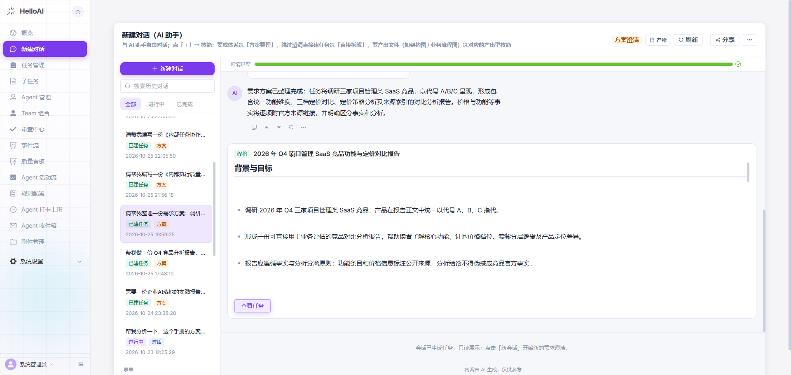 | 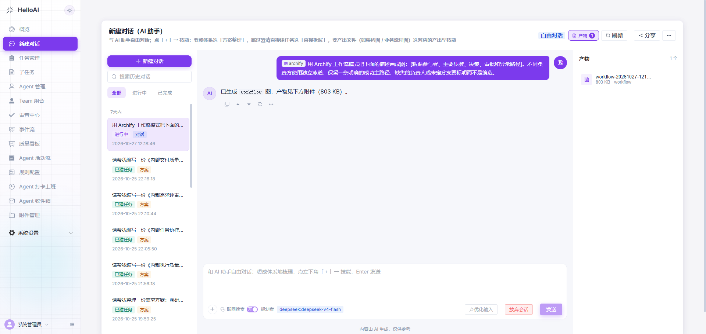 | 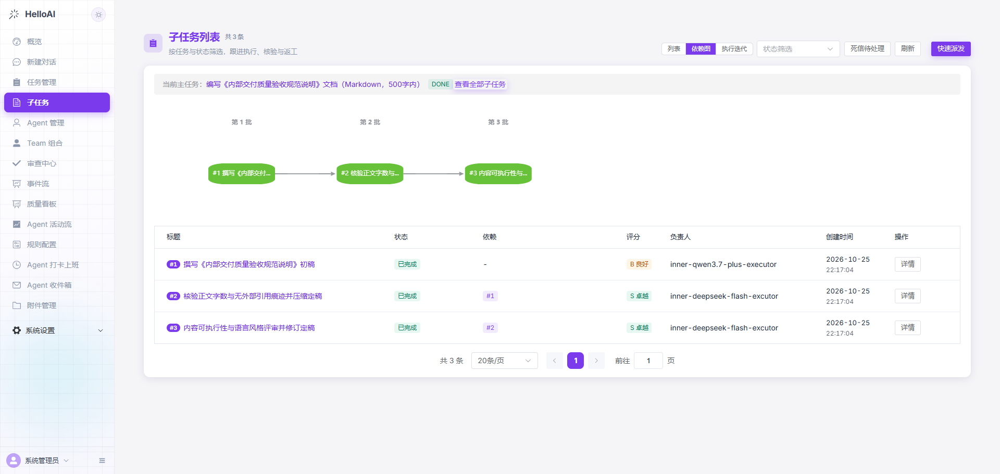 |

| 概览 | 任务管理 | Agent 管理 |
|:---:|:---:|:---:|
| 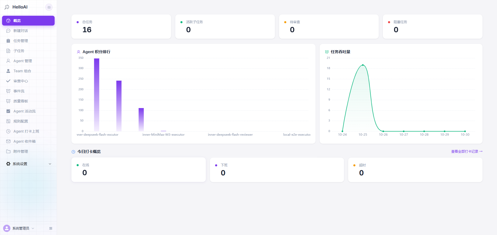 | 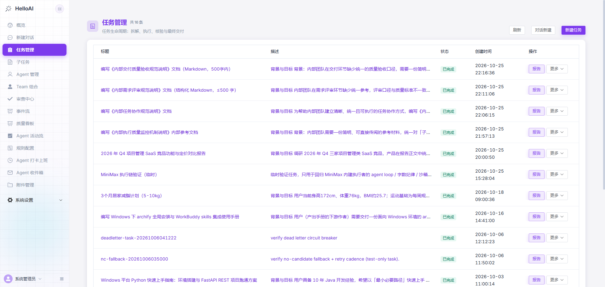 | 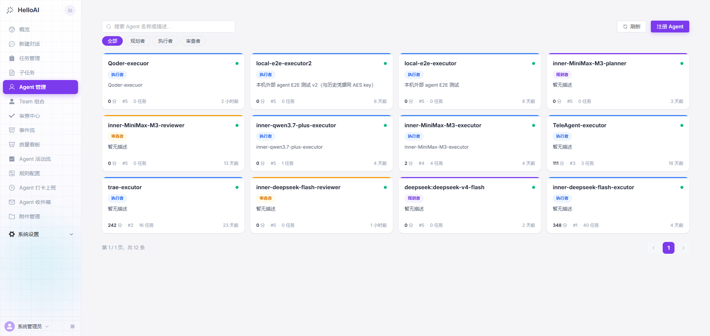 |

| Team 组合 | 执行迭代 | 子任务详情 |
|:---:|:---:|:---:|
| 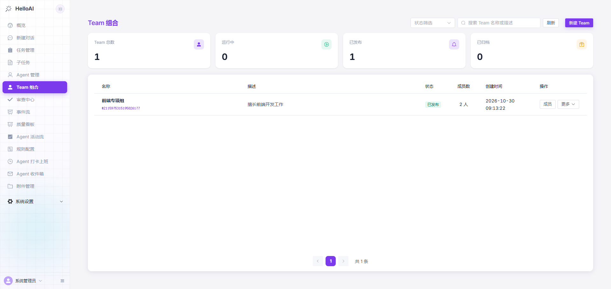 | 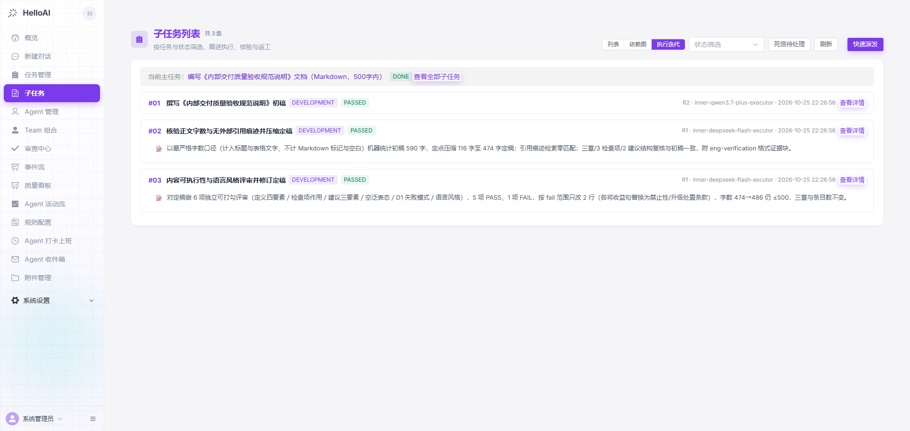 | 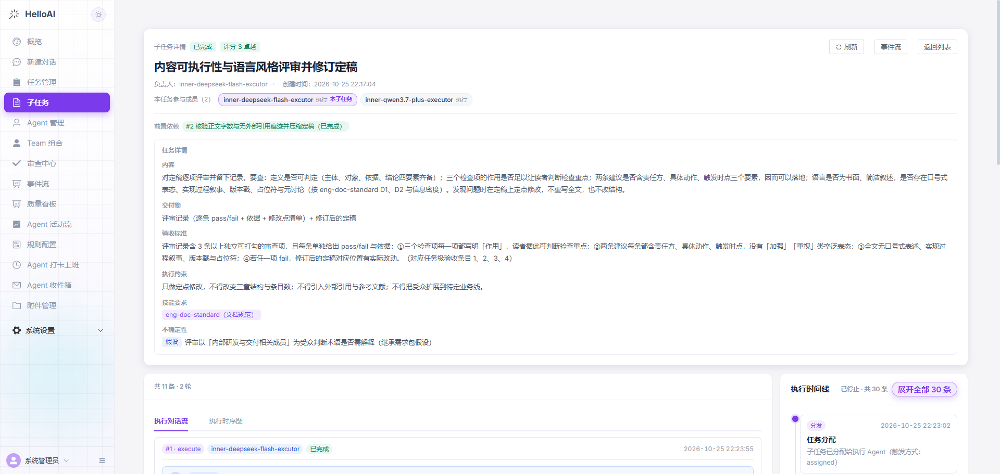 |

</div>

<details>
<summary><b>展开看细节：执行对话流 / 质量看板 / 审查中心</b></summary>

<table>
<tr>
<td width="33%" valign="top">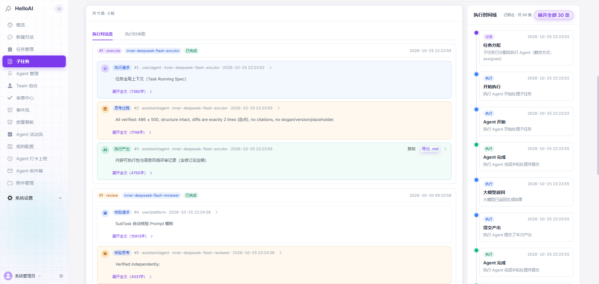<br><sub>执行对话流 —— 任务上下文 / 思考 / 产出 / 核验全过程</sub></td>
<td width="33%" valign="top">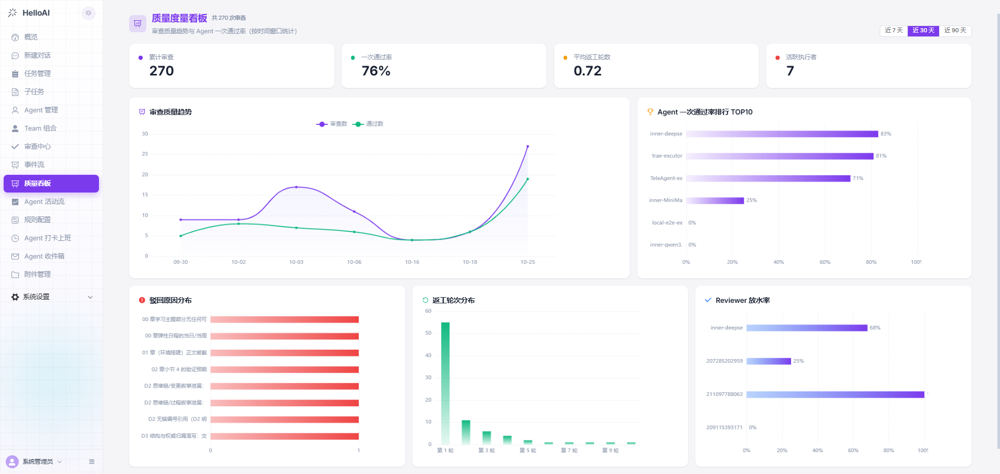<br><sub>质量看板 —— 一次通过率 / 返工轮次 / 驳回原因</sub></td>
<td width="33%" valign="top">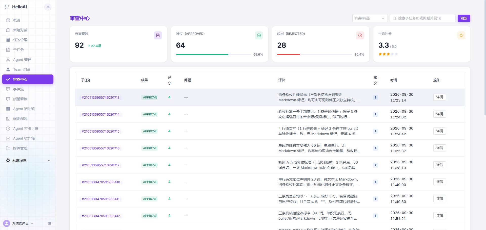<br><sub>审查中心 —— Reviewer 逐项验收与评分</sub></td>
</tr>
</table>

</details>

<details>
<summary><b>展开：外部 Agent 接入三件套（事件流回放 / 收件箱 / 打卡值班）</b></summary>

<table>
<tr>
<td width="33%" valign="top">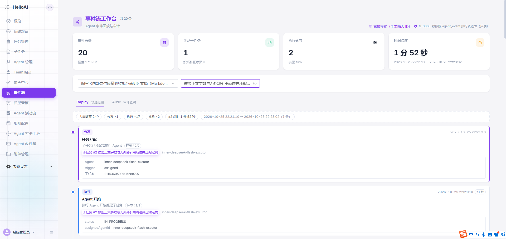<br><sub>事件流工作台 —— Agent 事件回放与审计追溯</sub></td>
<td width="33%" valign="top">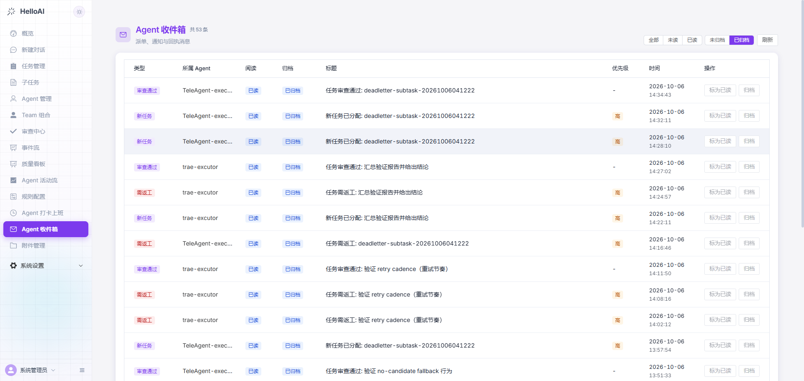<br><sub>Agent 收件箱 —— 派单 / 通知 / 返工消息投递</sub></td>
<td width="33%" valign="top">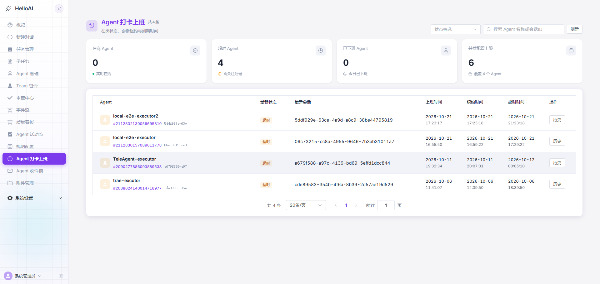<br><sub>打卡上班 —— 在岗状态 / 会话租约 / 到期时间</sub></td>
</tr>
</table>

</details>

<details>
<summary><b>展开：企业级权限体系（角色 / 接口权限 / 菜单路由）</b></summary>

<table>
<tr>
<td width="33%" valign="top">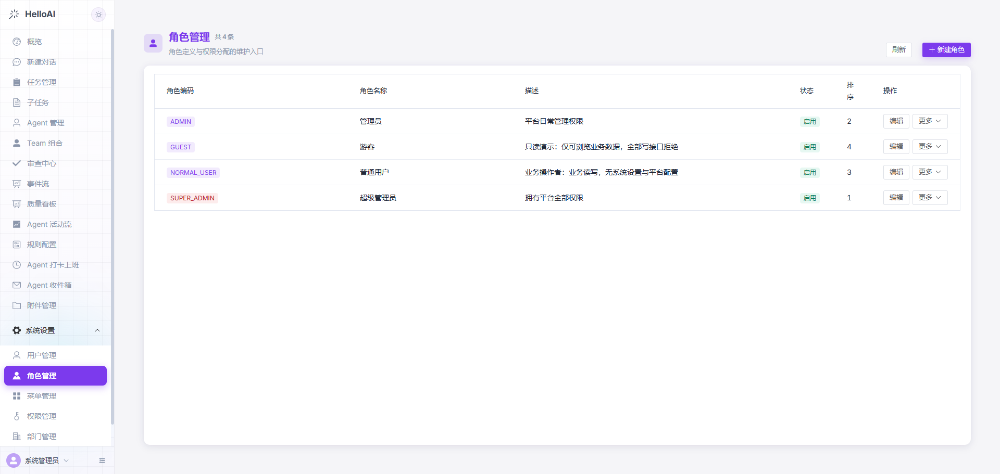<br><sub>角色管理 —— 超管 / 管理员 / 普通用户 / 游客</sub></td>
<td width="33%" valign="top">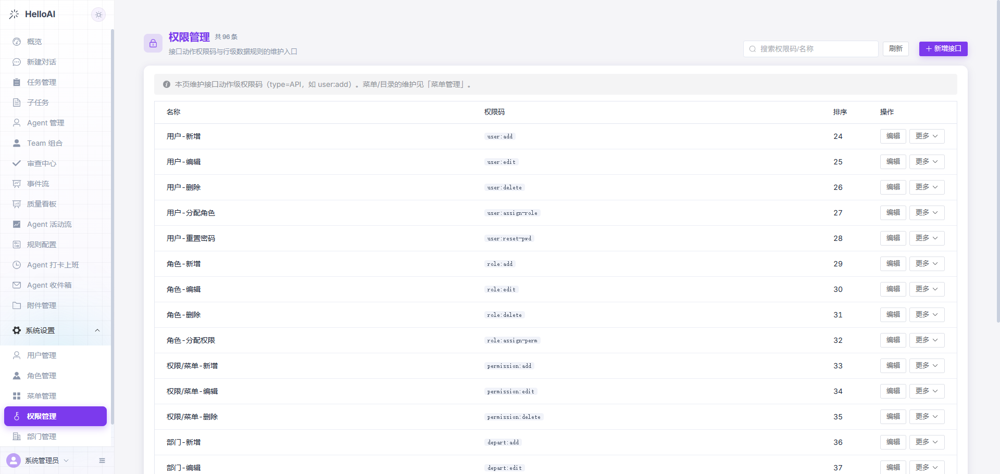<br><sub>权限管理 —— 接口级动作权限与行级数据规则</sub></td>
<td width="33%" valign="top">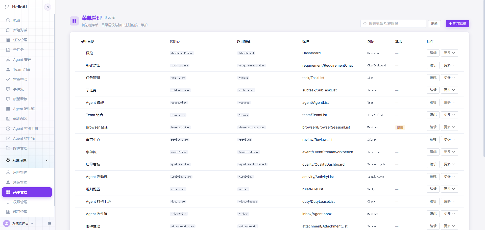<br><sub>菜单管理 —— 侧边栏 / 目录层级 / 路由注册</sub></td>
</tr>
</table>

</details>

更多截图见 [`doc/images/`](doc/images/)。

---

## 📚 文档导航

| 你想做什么 | 去哪里 |
|---|---|
| **了解架构设计** | [文档地图](doc/README.md) → 项目基线 / 目标架构 / 设计文档 |
| **接入外部 AI Agent** | [EXECUTOR 接入指南](.executor-onboarding.md) — SKILL 生成、MCP 连接、打卡流程 |
| **查外部 Agent 值守手册** | [值守手册](doc/manual/executor-duty/manual-assembled.md) — 值班 / 领任务 / 提交 / 心跳 / 排障 |
| **查看任务状态机** | [平台三级状态机](doc/diagrams/platform-state-machines.svg) — 主任务 / 子任务 / 整合报告联动 · [子任务状态机（11 态）](doc/diagrams/subtask-state-machine.svg) — 流转与异常路径 |
| **浏览交互式架构图** | [doc/diagrams/html/](doc/diagrams/html/) — 系统架构 / 平台调度 / 三级状态机 / Planner / Executor / Reviewer，均为可缩放、带图例的 HTML 版 |
| **了解适用边界** | [诚实的能力边界](doc/HelloAI_项目介绍.md)（§2.6） |
| **参与开发** | [代码规范](doc/HelloAI_CODE_STYLE.md) · [项目基线](doc/HelloAI%20项目基线文档.md) |
| **查看迭代记录** | [doc/log/](doc/log/) — 按月归档的功能线汇总 |
| **English** | [README.en.md](README.en.md) |

---

## 🗺️ 路线图

**已交付 ✅**

- [x] 双模 Planner（CHAT / CLARIFY）+ 联网搜索（总结 + 来源 + 补充检索）+ 自动任务拆解
- [x] 能力感知拆解：技能目录注入 + 三档粒度自适应（细 / 中 / 粗）+ 子任务级技能 / 约束显式化 + 草案人工修订
- [x] 需求包准入：目标 / 范围 / 排除项 / 假设 / 待确认五字段 + 不确定性分级（自证 / 上报人工裁决）
- [x] 弹性调度：外部优先 + 空闲优先 + 值班优先 + LLM 保底 + 熔断降级 + 多外部执行者同台按分排序
- [x] MCP 外部 Agent 接入（13 个工具）+ 值班租约 + 任务感知轮询 + 子任务上下文三通道供给
- [x] Reviewer 双轨纪律制 + 多轮驳回返工（缺失证据清单）+ 双审共识 + 抽检复审
- [x] V2 执行体系：统一事件流（Run / Turn / Step）+ AgentRuntime 八件套 + Replay / Audit 事件流工作台 + **Recovery 恢复面**（只读恢复点投影 + 续跑注入兜底）
- [x] 生产级可靠性：Outbox 四态 + 三层幂等 + 死信人工兜底 + Reconcile
- [x] 全链路可视化：依赖 DAG / 时间线 / 时序图 / 事件流工作台 / 质量看板
- [x] 最终整合报告（五态状态机 + 三级容错 L1/L2/L3 + 版本回滚）+ 交付物 zip 一键下载
- [x] RBAC 权限体系：Sa-Token 登录 + 用户 / 角色 / 菜单 / 部门 + 动作级权限码 + 数据权限
- [x] Docker Compose 完全私有化部署
- [x] 内部 LLM 执行链：工具面解封（读附件 / 交付登记 / 自报阻塞）+ 技能惰性加载 + 取消 / 超时树 + 截断显式终态 + 用量拆分（REF-8 / G-021 / G-023）
- [x] 沙箱执行链：OpenSandbox 受控验证通道 + 按子任务生命周期复用 + 工作区回读兜底（ADR-005 / S-7~S-9）
- [x] 任务拆解领域无关化：六类任务原型 + 四类验收判据 + 拆解提示词分档 + 澄清停滞守卫 + 单条草案细拆 / 重写（TD-1~TD-9 / TD-11）
- [x] 联网搜索效果优化：动态 freshness + 并行搜索 + 搜索词质量（W-1~W-4）
- [x] 需求对话附件：附件意图三态 + 文本 / PDF 注入 + 检索多变体（ATT-1 / ATT-5 / ATT-6）
- [x] 供应商 / 模型注册信息完善：模型目录 + 能力谓词 + 多 Key 主备（M-1~M-9）
- [x] 多模型执行者实测：DeepSeek / MiniMax / Qwen 三个内部 LLM 执行者真机对照画像（2026-10-25）

**待办 🔜**

- [ ] Sandbox Provider 化真实隔离：Docker / Remote / K8s 执行环境（执行链已作为内部 LLM 受控验证通道落地；Provider 化隔离仍条件触发，见 `doc/HelloAI 实现差距表.md` G-005）
- [ ] Quality Gate 自动化门槛：Rule + Test + LLM 统一决策（G-007）
- [ ] Agent Fleet 能力化选人：成本维度已入比较链，候选间比较待第 2 个 LLM agent 样本（G-008）
- [ ] 需求对话附件视觉直读与大文件 RAG（ATT-2 / ATT-3）
- [ ] 外部 Agent 工作详情快照：事后经审批的可选取证通道（G-020）
- [ ] CLI 推通道：适配器 / 输出解析 / 会话续接（Paperclip 借鉴阶段二）
- [ ] Dynamic Workflow：动态分支与运行期编排（远期）
- [ ] 领域模板市场（技术方案 / 代码审查 / 文档生成）
- [ ] 浏览器型 Agent（WEB_BROWSER）真实接入链路
- [ ] 多租户（数据级租户隔离）
- [ ] 调度核心多实例水平扩容（双锁体系已打底）
- [ ] 更多外部 Agent 适配器

> 完整路线图与历史迭代见 [doc/log/](doc/log/) 与 [项目基线](doc/HelloAI%20项目基线文档.md)。

---

## ❓ FAQ

**Q：A2A 是什么？HelloAI 和它是什么关系？**

A：MCP 让 Agent 会用工具，A2A 让不同厂商的 Agent 能互相协作。协议标准已经有了，但"谁拆活、派给谁、验收什么、失败怎么兜、事后怎么对账"这一层落地机制仍然缺——这正是 HelloAI 补的位置。严格说，HelloAI 不是 A2A 协议规范的实现（Agent 接入走 MCP），补的是协作机制。

**Q：与 CrewAI / LangGraph / Dify 有什么区别？**

A：一句话：它们解决"如何写 Agent / 编排应用"，HelloAI 解决"**如何管 Agent**"——任务拆解、弹性调度、验收审计、全链路可视化，且基于 Java 企业级技术栈。

**Q：必须部署 Java 环境吗？**

A：是。JDK 17 是项目红线，另需 Docker Compose 拉起 PostgreSQL / Redis / RabbitMQ / MinIO 基础设施，步骤见[快速开始](#quick-start)。

**Q：支持哪些大模型？**

A：DeepSeek 实测可用，Moonshot / MiniMax / DashScope 预置。启动后在管理端「系统设置 → 模型配置」填写 API Key 即可，加密存储、实时生效、无需重启。

**Q：接入外部 AI（Qoder / Trae / Codex CLI / Claude Code）要改它的代码吗？**

A：不用。管理端创建 Agent 后一键生成 SKILL 说明，粘贴给外部 AI 执行，即可自动完成注册鉴权 → MCP 连接 → 值班打卡 → 轮询值守。

**Q：数据会离开我的服务器吗？**

A：支持完全私有化部署，任务、产出物、审计记录全部落在你自己的数据库；LLM API Key 经 AES-GCM 加密存入凭证库。任务内容仅会发送给你自行配置 API Key 的大模型服务。

---

## 🤝 参与贡献

1. Fork 本仓库
2. 新建 `feat_xxx` 或 `fix_xxx` 分支
3. 改代码前必读 [`doc/HelloAI_CODE_STYLE.md`](doc/HelloAI_CODE_STYLE.md)；涉及调度 / 执行链改动先读 [`doc/design/Agent_Runtime.md`](doc/design/Agent_Runtime.md) 与 [`doc/design/Agent_Event_Stream.md`](doc/design/Agent_Event_Stream.md)
4. 提交前跑通与改动面相关的 `scripts/` 验证脚本，PR 附上脚本输出

**提交前必跑的门禁**（本地与 CI 跑的是同一份脚本，结果可复现）：

```bash
bash scripts/ci/ci-gate.sh                    # 全量：构建 + 真实单测 + 用例数>0 + 架构冻结 + 前端
bash scripts/ci/ci-gate.sh --quick --skip-ui  # 快速自检
```

> ⚠️ **两个高频坑**：① 默认 `JAVA_HOME` 若指向 `ms-17.0.19` 会触发 JVM `EXCEPTION_ACCESS_VIOLATION`
> （表现成「项目编译不了」，其实是环境问题），改用 `ms-17.0.20.1` 或任一可用 JDK 17；
> ② 根 POM 默认 `skipTests=true`，手工跑测试必须显式 `-DskipTests=false`，否则拿到的是
> 「0 用例通过」的假绿。
>
> 涉及跨域依赖的改动还要过架构红线守卫：`bash scripts/ci/check-arch-freeze.sh`
> （反向依赖计数只降不升；确需新增时用 `--update-baseline` 刷新基线，并在 PR 说明理由）。

脚本用法、门禁分档、CI 跑在自有主机组时的准备步骤，详见 [`scripts/README.md`](scripts/README.md) §六。

---

## 🙏 致谢与参考借鉴

本项目在设计与实现过程中参考了以下开源项目（详细落点见归档文档）：

- **[OpenMOSS](https://github.com/undefined-404/OpenMOSS)** —— Agent 接入层 + 角色建模层 + Prompt/Skill 资产层
- **[AgentTeams](https://github.com/agentscope-ai/AgentTeams)** —— 调度内核 + 执行边界 + 状态收敛模型
- **[DeepSeek Harness](https://github.com/deepseek-ai/deepseek-harness)** —— `eng-*` 平台技能规范库与 Reviewer 双轨纪律制
- **[Vibe-Skills](https://github.com/foryourhealth111-pixel/Vibe-Skills)** —— 工作流运行时设计参考

许可兼容性以各上游 LICENSE 为准。

---

## 📄 许可证

本项目采用 [MIT 许可证](https://opensource.org/licenses/MIT) 开源，详见 [LICENSE](LICENSE)。

---

**Let AI Agents Work as a Team.**
