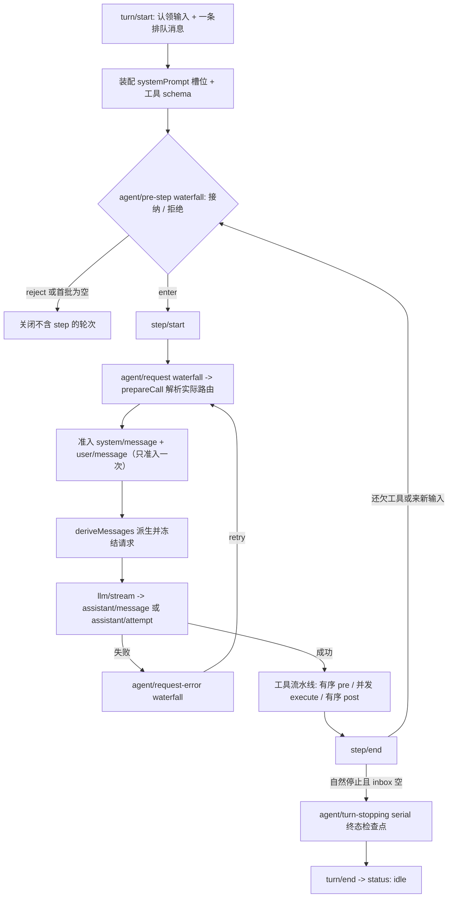
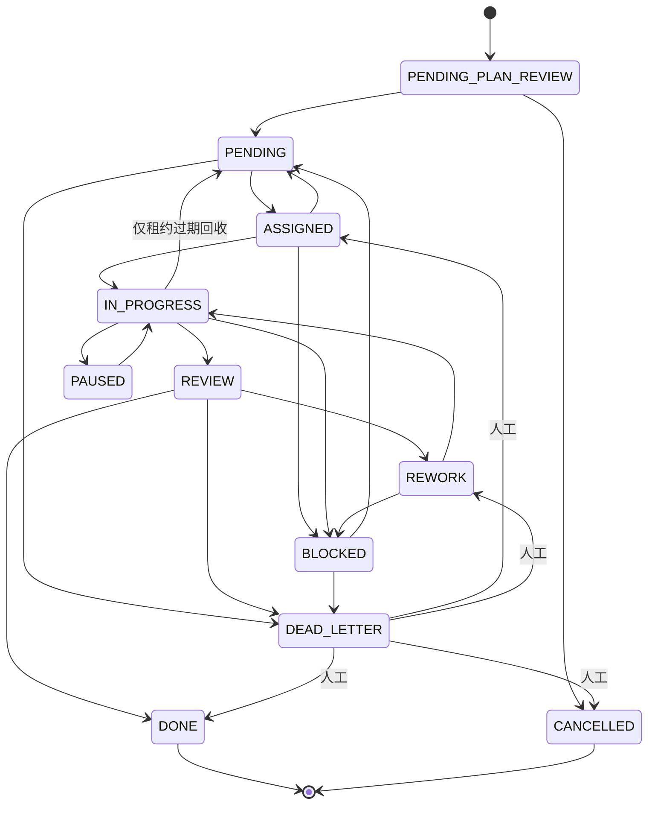

# DSH 与 HelloAI 执行流与状态机比对（2026-10-13）

> **用途**：回答「内部 LLM 调用逻辑照抄 DSH」时，先弄清 DSH 到底怎么跑、它有没有「LLM 更换」机制、以及 HelloAI 要落地需要动哪一层。
> **数据源**：DSH 本地 checkout `E:/workspace/deepseek-harness-master`（`0.2.1-alpha.2`）；HelloAI 本仓源码（行号均为实测）。
> **结论先行**见 §0；**可移植性判据**见 §5。
> **决策落点**：`plan/HelloAI 借鉴落地实施计划.md` §10.7（含 §10.7.6 增补）。

---

## §0 三句话结论

1. **DSH 没有「LLM 内部换模型」这一机制**——它的模型路由是**创建 agent 时声明**、**重试也不换 route**；要「换执行者」在 DSH 里是**委派 subagent**（新会话 + 自己的路由），不是同一执行流内偷偷换。故「照抄 DSH」不会得到「循环内换 apiKey」这个方案。
2. **HelloAI 不需要改任务状态机**——「发现无能力 ⇒ 交回平台换人」这条路的**状态转移与重派链已经存在**（`BLOCKED → PENDING → ASSIGNED(新 agent)`，`SubTaskStateMachine:31` + `SubTaskDispatchServiceImpl.dispatchBlockedSubTask:70-95`）。缺的只是「自动触发」那一环的**接线**，不是状态机。
3. **能力鉴别应按「发现 / 处置」切分，而非「内 / 外」二选一**：**发现放内部 LLM**（它最清楚缺什么，且已是既有 `internal_report_blocked` 通道）；**处置放平台派发层**（复用既有重派链，零状态机改动、不进评审、不烧评审轮次）。这条同时满足「状态机不变」与「DSH 式可移植」两个诉求。

---

## §1 DSH 的真实形态（实测）

### 1.1 处理流（一个 turn）



**语义刻度**（`docs/architecture.zh.md:85` 原话）：**一个 step = 一次模型请求 + 它调用的工具**；**一个 turn = 0..N 个 step**，在领取首条输入前打开、不再欠工作时关闭。

**四个扩展点**（`docs/architecture.zh.md:110`）；**三个可拦截点**正是挂点候选：

| 挂点 | 类型 | 能力 | 源码 |
|---|---|---|---|
| `agent/pre-step` | **waterfall**（必须 `next()`） | 改写/拒绝已领取消息；压缩在此触发 | `packages/core/agent-loop/src/agent.ts:275` |
| `agent/request` | **waterfall** | 分发前改写请求（含补齐/覆盖 `provider`+`model`+`reasoningEffort`） | `agent.ts:594` |
| `agent/request-error` | waterfall | 返回 retry 或保留原错 | `agent.ts:512` |
| `agent/turn-stopping` | **serial**（无 `next()`） | 终态检查点，可停止轮次 | `agent.ts:362` |

**两条旁路（与 HelloAI 最相关的）**：

- **压缩**：`compaction-basic` 在**派生请求之前**经 `agent/pre-step` 处理（`packages/compaction/compaction-basic/src/index.ts:158`）——**不等溢出**；`agent/request-error` 只服务「规范上下文溢出」（同文件 `:190`）。顺序 = **先剪工具结果 → 再摘要**；恢复在**仍打开的 step 内**，且**只有 `surface.replaceGeneration` 推进才重试**（`:202/212/230`）。
- **重试**：`packages/llm/llm-retry` 在**持久 step 边界**重跑失败步骤（同轮次内），**只针对暂时性失败**（速率限制 / 服务端错误 / 超时 / 传输错误）；`retryPolicy` 配在**各 provider 路由**上。**重试不换 route。**

### 1.2 状态机（DSH 的「状态」极少）

```text
AgentStatus = 'idle' | 'running'        // packages/core/agent/src/runtime-types.ts:109
```

DSH **没有业务状态机**——它没有编排层（无 planner / review / dispatch）。turn / step 是**结构**不是状态；终态只有「轮次结束、status 回到 idle」。真正的「进度」承载在 **goal** 域（每会话一个持久目标，`update_goal` 可置 blocked）与 **goal-round-driver**（把进行中的目标变成连续 Round，= DSH 的**内容级外层循环**）。

### 1.3 「LLM 更换」在 DSH 里到底是什么

| 问题 | DSH 的实测答案 | 证据 |
|---|---|---|
| 模型谁定？ | **agent 创建时声明**（`agents[].provider` / `agents[].model`）；缺则**抛错**，不自动挑 | `agent.ts:598-599`；`packages/core/agent-loop/README.zh.md` 配置表 |
| 运行中能换吗？ | **不是 shipped 行为**。`agent/request` 中间件**可以**改 route（分发前），但默认 route 从声明取、持久配置只在 provider+model 都相同时才恢复 | `agent.ts:571-607` |
| 改默认模型的生效范围？ | **只影响之后由它解析选择的 agent**；已建立前缀不失效 | `packages/core/agent-default-model/README.zh.md`（KV Cache 影响段） |
| 重试会换模型吗？ | **不会**。重试同一条 route | `packages/llm/llm-retry/README.zh.md` |
| 「换执行者」怎么做？ | **委派 subagent**（进程内新 agent / 带父历史 / 进程外 ACP、Codex、Claude Code、另一 Harness），子 agent 自带路由与 `toolFilter`/`maxDepth` | `packages/subagent/README.zh.md` |
| 「承认做不到」怎么做？ | `update_goal` 置 **blocked**（带连续 N 轮门槛） | `packages/goal/README.zh.md`；research §1.5.3 |

> **对用户的直接回答**：「DSH 内部流转包含 LLM 更换」**不成立**。DSH 的层次是「**同 agent 内 route 固定**（重试也不换）+ **跨 agent 靠委派**」。所以「LLM 内部换 apiKey」在 DSH 里**找不到可抄的实现**；而它的「换执行者」对应物在 HelloAI 是 **`BLOCKED → 重派链`**，不是循环内换密钥。

---

## §2 HelloAI 的真实形态（实测）

### 2.1 子任务状态机（`SubTaskStateMachine.java:17-37`，11 态）



### 2.2 「能力不足」在 HelloAI 有**两条**出边（这是本轮的关键发现）

| | 出边 ①：走评审驳回 | 出边 ②：报阻塞换人 |
|---|---|---|
| 触发 | 评审判定不通过 | 执行者**自报**阻塞 |
| 转移 | `REVIEW → REWORK`（`SubTaskServiceImpl:792-824`） | `IN_PROGRESS/ASSIGNED/REWORK → BLOCKED`（`SubTaskServiceImpl:1002-1040`） |
| 计数 | `reworkCount + 1`，且 `attempt_total + 1` | `reworkCount` **不变** |
| 是否进评审 | **要**（须先物化产出 + 送审，烧一次评审 LLM） | **不进**（`ExecutionResultHandler:197`「状态非 IN_PROGRESS 即丢弃上报」挡住） |
| 换人链 | 返工重派（同/换 agent） | **`SubTaskDispatchServiceImpl.dispatchBlockedSubTask:70-95`**：闸门（熔断+退避）→ `accumulateReassignAttempt` → `resetToPendingForDispatch(BLOCKED)` → `assignNext`（选人/fallback） |
| 现存调用方 | 自动核验驳回（`SubTaskReviewServiceImpl:648-660`） | `SubTaskController.reassignById`（人工，需 `subtask:reassign`）+ `redispatchInProgress`（人工） |

**共享预算**：两条出边**都**消耗同一个 `attempt_total`（上限 `helloai.dispatch.max-reassign-attempts = 5`，`AgentDispatchProperties:70`）。`SubTaskServiceImpl:829` 注释明写「与调度重分配 incrementAttemptTotal 同款 SQL」，目的就是**杜绝「返工 3 次 × 重派 5 次 = 8 次」的叠加放大**（坑点 3「单一权威」）。

**退避闸门**：`REASSIGN_BACKOFF_SECONDS = {60, 180, 600, 1800}`（`SubTaskDispatchServiceImpl:67`），退避时钟绑 `sub_task.last_attempt_time`（V102 修 804）——**「换人」入口不享受特权**。

### 2.3 迭代时间线（用户提到「迭代记录」不难调的那部分）

**Turn 序号 = `1 + reworkCount + attemptTotal`**（`AgentEventContextResolver:29-42`，ADR-001 §3.2）。

- `rework` ⇒ `reworkCount + 1` ⇒ 新 Turn；
- 自动驳回返工 / 超时回收重派 / N11 回退 ⇒ `attemptTotal + 1` ⇒ 新 Turn；
- 人工裁定开启新一轮（`reworkFresh` / `redispatchDeadLetter`）⇒ **清零重计**（序号回落为已知近似）。

### 2.4 内核现状（可移植性相关，见 §5）

| 构件 | 现状 | 移植障碍 |
|---|---|---|
| `ChatModelToolLoop` | 手写工具循环；两处压缩挂点**硬编码内联**（`:106` / `:123`）；调**裸 `ChatModel`**（`:115`） | 直接写 `AgentEventType.*` 平台事件枚举 |
| `AgentLoopInput` | 13 字段，含 `runId / taskId / subTaskId / turn / agentId / eventRecorder` + `loopCheckpointListener` | **6 个平台概念进内核** ⇒ 内核认识 `task/subTask` |
| `ToolInvocationContext` | `static` 线程局部绑定 | 单实例假设（与 V1→V2 冲突） |
| `RuntimeTurnExecutor:187-196` | 「空产出护栏」：SUCCESS→FAILED（只改 `ExecutionStatus`） | 平台语义（`ExecutionStatus`）在内核出口翻译 |

---

## §3 逐项比对

| 维度 | DSH | HelloAI | 判定 |
|---|---|---|---|
| 编排层 | **无**（一个人的 harness） | planner > review > task > agent > system（5 层） | **不抄**（research §1.6.1 已裁） |
| 内层循环 | turn / step（step = 1 次模型请求 + 其工具） | 一次 `agentLoop.run`（内部 `for(i<maxIterations)`） | **结构等价**，骨架不缺 |
| 外层循环（内容级返工） | `goal` + `goal-round-driver`（连续 Round） | `REVIEW → REWORK` + `attempt_total` 预算 | **各有其位**，语义可对齐 |
| 状态机规模 | 2 态（idle/running）+ goal 状态 | 11 态子任务机 + 6 态核验出口 | HelloAI **重得多**，但**自洽** |
| 拦截点 | 3 个（pre-step / request / request-error）+ 1 serial（turn-stopping） | **仅 2 个**（`ChatModelToolLoop:106` / `:123`），且**硬编码内联**；**无 turn-stopping 等价物** | **缺口明确** = `REF-8.4` |
| 压缩 | `agent/pre-step` 压力 + `agent/request-error` 溢出；**先剪枝再摘要** | 同序（`ContextCompactor` + `ToolResultPruner`），挂点已实现 | **已对齐**（`REF-8.2.3`） |
| step 内重试 | `llm-retry`：同轮次重跑失败步骤，**不换 route** | `ChatModelToolLoop:113-134` 的 `while + overflowRetries`（**只覆盖溢出**） | 有骨架，**未通用化**（建议 defer 采样） |
| 换模型 | **运行中不做**；agent 创建时声明；改默认只影响之后创建的 agent | `apiKey` 是 Agent 实体字段，一次执行内固定 | **一致**（都不换）——故「循环内换 key」**两边都没有先例** |
| 换执行者 | **委派 subagent**（新会话 + 自有路由） | **`BLOCKED → 重派链`**（`dispatchBlockedSubTask`） | **语义等价物已存在** |
| 承认做不到 | `update_goal` 置 blocked（连续 N 轮门槛） | `internal_report_blocked` → `BLOCKED` + 人工介入（`REF-8.1.1`，**已实施**） | **已对齐** |
| 会话真源 | 会话日志唯一真源；**模型可见 ⟺ 已记录** | `agent_event` append-only + Outbox 双写 + 终态投影 | 方向一致（会话单源化已降支撑项） |
| 事件域 | **持久**（`session/event`）vs **实时**（`agent/*`） | 单套 `AgentEventType` + timeline | 可借：域划分有利于回放/实时分离 |

---

## §4 能力鉴别的三种落点（本轮分歧点的裁定）

### 方案 A：搁在 LLM 内部流程 —— 走评审驳回

`REVIEW → REWORK` ⇒ `reworkCount+1` + `attempt_total+1`。**代价**：须先物化产出并送审（多烧一次评审 LLM），且把「能力不足」记成「质量不合格」，污染 `reviewHistory` 语义。

### 方案 B：搁在 LLM 内部流程 —— 循环内换 apiKey / 换模型

**不可采纳**，三条独立理由：
1. **DSH 无对应实现可抄**（§1.3）——「照抄标杆」这条原则本身否定它；
2. **平台不可见**：`apiKey` 与 model 是 Agent 实体属性，循环内换掉后 `agent_execution_record` 记录的仍是原 agent ⇒ **成本画像（`costSampleLimit`/性能分）与质量画像被污染**，评审打分的输入不再可信；
3. **会话流歧义**：对话流按 `agentId` 归属，同一 Turn 内换了模型但归属不变 ⇒ 回放读不出「这句是谁生成的」。

### 方案 C（推荐）：**发现放内、处置放外**

```text
内部 LLM 内部流程
  └─ 发现自己缺能力（结构化事实：缺什么 / 试过什么 / 需要什么）
       └─ internal_report_blocked（已实施，带知情拒绝闸门）→ 落 BLOCKED
平台派发层（零状态机改动）
  └─ dispatchBlockedSubTask：熔断 + 退避 + 选人 + fallback → ASSIGNED(新 agent)
```

**为何这是「照抄 DSH」而非背离它**：
- DSH 的 `agent/pre-step` 语义就是「**接纳 / 拒绝这批输入**」——**拒绝是循环内的能力**；而「拒绝之后谁接手」DSH 交给**委派 seam**。方案 C 正是这个切分：**拒绝/自省在内核**，**接手在平台**（平台的派发层 = DSH `subagent` seam 的位置对应物）。
- 具备**可移植性**：内核只需产出「我需要 X 能力但没有」这个**结构化事实**（纯数据契约），由适配器翻译成平台的 `BLOCKED`。内核**不认识** `SubTaskStatus`。

**仍需接线的一环**（唯一缺口）：`dispatchBlockedSubTask` 现存调用方都是**人工入口**（`reassignById` 需 `subtask:reassign`）+ `redispatchInProgress`。要让「自报阻塞」自动进入重派链，需要**在平台侧**加一个触发点（两条候选，均不改状态机）：
- **(a) 同事务接线**：`internal_report_blocked` 的处置里，BLOCKED 落库后若存在同角色可替代候选，调用 `dispatchBlockedSubTask`（它本身带闸门，安全）；
- **(b) 巡检接线**：仿 `SubTaskPendingOrphanTask` 增加对「因 `blockedReason=能力不足` 而 BLOCKED」的巡检自动重派。

> **红线核对**：`internal_report_blocked` 是**显式工具动作**（等同外部 agent 的 MCP 工具），按既有「合法性双口径」**可以**改平台状态机；而 `dispatchBlockedSubTask` 是平台自身服务，走既有闸门。⇒ 两条红线均不破。

---

## §5 可移植性判据（用户最关心的一项）

### 5.1 DSH 的可移植性来自什么（可核对的五条）

1. **一切皆插件**，含 agent loop 本身可替换（`docs/architecture.zh.md:9-11`：无特权内核）。
2. **seam 三角色**（Service Definition / Provider / Consumer）——换一个提供方就换掉整条能力（`:134-138`）。
3. **事件分域**：持久（`session/event`，可回放）vs 实时（`agent/*`）（`:73-75`）。
4. **铁律「模型可见 ⟺ 已记录」**：`deriveMessages()` 从日志投影（`:128`）。
5. **内核不认识业务**：agent loop 只依赖 `agent` / `session` / `ctx.llm` / `ctx.tools`；「新行为归属位置」有明文映射表（`:146-168`）。

### 5.2 判据（建议写死为 `REF-8` 的可移植性验收口径）

> **内核可移植 ⟺ 内核只依赖「抽象对话模型 + 工具集 + 会话日志」三样，不认识 `task` / `subTask` / `turn` / `agentId` / 平台事件枚举。**

按此判据逐条核对，**HelloAI 现状不符**：

| 项 | 现状 | 结论 |
|---|---|---|
| 内核输入含平台概念 | `AgentLoopInput` 的 `runId/taskId/subTaskId/turn/agentId/eventRecorder`（6 项） | ✗ |
| 内核写平台事件枚举 | `ChatModelToolLoop` 直接 `AgentEventType.TOOL_CALL_STARTED/COMPLETED` | ✗（应改为内核领域事件 + 适配器翻译） |
| 挂点是否具名 | 两处硬编码内联 | ✗（`REF-8.4` 第一件事） |
| 内核是否可脱离 Spring 构造 | 有「无压缩器构造」，但 `ToolExecutor`/`AgentEventRecorder` 仍是内核入参 | 部分 |
| 线程模型 | `ToolInvocationContext` 为 `static` | ✗（单实例假设） |

**因此**：`REF-8.4` 的挂点抽象是**必要不充分**。要达到 DSH 那种可移植性，还需一次 **「内核输入契约收敛」**（平台概念出内核 ⇒ 内核产领域事件、适配器翻译成平台事件）。

⚠️ **与既有红线的张力（需用户裁定）**：`plan` §10.5 写着「**不动 `ChatModelToolLoop` 循环本体**」（骨架正确）。而可移植化必然要动它的**输入契约与事件出口**。二者不必然冲突（可「不动循环逻辑、只动入参/出口」），但**必须显式裁定**：可移植性是**本轮范围**，还是**登记为独立待办**。

---

## §6 证据索引

| 侧 | 路径 | 要点 |
|---|---|---|
| DSH | `docs/agent-lifecycle.zh.md` | 时序图（mermaid）全文 |
| DSH | `docs/architecture.zh.md:81-120` | turn-flow 文字版；四个扩展点；事件分域 |
| DSH | `docs/architecture.zh.md:134-168` | seam 三角色；新行为归属位置表 |
| DSH | `packages/core/agent-loop/src/agent.ts:275 / 362 / 512 / 594` | pre-step / turn-stopping / request-error / request |
| DSH | `packages/core/agent-loop/src/agent.ts:571-607` | route 从声明取；缺 provider/model 抛错；`prepareCall` |
| DSH | `packages/compaction/compaction-basic/src/index.ts:158 / 190 / 202` | 压力触发 / 溢出恢复 / replaceGeneration 守卫 |
| DSH | `packages/llm/llm-retry/README.zh.md` | 步骤边界重试；不换 route；同一打开的轮次内 |
| DSH | `packages/core/agent-default-model/README.zh.md` | 改默认只影响之后创建的 agent |
| DSH | `packages/subagent/README.zh.md` | 委派换执行者的能力家族 |
| DSH | `packages/goal/README.zh.md` | 持久目标 + 自动续行（内容级外层循环） |
| DSH | `packages/core/agent/src/runtime-types.ts:109` | `AgentStatus = 'idle' \| 'running'` |
| HelloAI | `helloai-common/.../SubTaskStatus.java` | 11 态 |
| HelloAI | `helloai-core/.../task/statemachine/SubTaskStateMachine.java:17-37` | 转移表 |
| HelloAI | `helloai-core/.../task/service/impl/SubTaskServiceImpl.java:792-824 / 829-870 / 1002-1040 / 1193` | rework / 共享预算熔断 / block / reassign |
| HelloAI | `helloai-core/.../task/service/impl/SubTaskDispatchServiceImpl.java:67 / 70-95 / 469-514` | 退避常量 / dispatchBlockedSubTask / redispatchInProgress |
| HelloAI | `helloai-common/.../config/AgentDispatchProperties.java:70 / 131 / 146 / 163` | max-reassign-attempts / autoReviewMaxRework / 重复失败短路 / 执行密集闸门 |
| HelloAI | `helloai-core/.../agent/event/AgentEventContextResolver.java:29-42` | Turn = 1 + reworkCount + attemptTotal |
| HelloAI | `helloai-core/.../agent/runtime/loop/impl/ChatModelToolLoop.java:106 / 115 / 123` | 两挂点 + 裸 ChatModel 调用 |
| HelloAI | `helloai-core/.../agent/command/ExecutionResultHandler.java:197` | 平台状态机唯一边界 |
| HelloAI | `helloai-core/.../agent/runtime/tool/InternalLlmExecutorTools.java:217-249` | `internal_report_blocked` |
| HelloAI | `plan/HelloAI 借鉴落地实施计划.md` §10.7 | 本轮范围与红线②判定 |
| HelloAI | `research/HelloAI 内部 agent 内核收敛与借鉴思路（2026-10-12）.md` §1.5~§1.7 | DSH 调用链 / 角色形态 / 影响面 |
